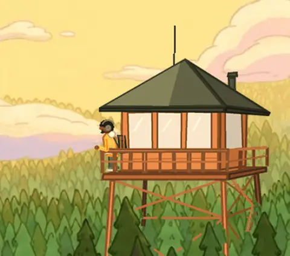
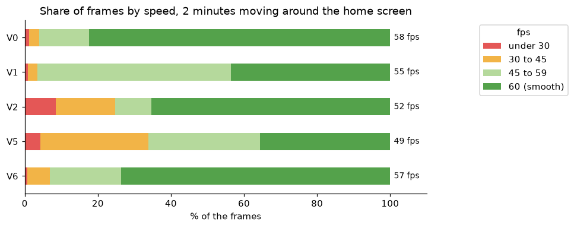

# TV Personalize Upgrade

**[Download the launcher (APK) and the install guide](https://github.com/CaueFabrizioBS/TV_personalize_upgrade/releases/latest)**

A new, ad-free home screen for a TCL Google TV (Android 12, 2 GB of RAM), and a data analysis of whether it actually
runs better than the factory one.

The TV came with Google's home screen: ads, pre-installed extras and a launcher that's slow to come back to. This
project replaced it with a customized fork of the open-source [Free My TV](https://github.com/simbasjungles/free-my-tv)
launcher, with an animated, illustrated sky that follows the clock and the real weather, a lookout tower and music
scenes, and measured every version along the way, from data collected on the TV itself.

<p align="center"></p>

## The project, step by step

| Version | Step | What changed on the TV |
|---|---|---|
| **V0** | Starting point | Google's factory home screen, every pre-installed extra on |
| **V1** | Cleanup | 20 unused extras turned off (never uninstalled), animations at 0.5x |
| **V2** | New home screen | Free My TV as published |
| **V5** | The fork | animated sky, weather, lookout tower and music scenes |
| **V6** | Optimization | the same scenes, with the sky in its own layer at half resolution |

Every version went through **the same test** (`collector/benchmark.py`): restart the TV, rest 3 minutes on the home
screen, then measure memory, how fast the home screen comes back from another app, 2 minutes moving around it with the
arrows, and opening Netflix, Nuvio and Spotify.

## Key findings

Only the differences bigger than the measurement noise count (the same version changed up to 11% between two runs,
so a gap must be above 15%, or above 2 fps for smoothness). The notebook shows how this was decided.

* **Back to the home screen about 25% faster:** 100 to 114 ms with Free My TV, against 138 to 148 ms with Google's.
* **28% less memory than Google's home screen:** 145 MB against 200 MB, even with the animated sky.
* **As smooth as the factory home screen:** the first version of the fork stuttered (49 fps) because the TV's graphics
  chip repainted the whole sky on every frame; giving the sky its own layer brought it to **57 fps**, against 58 for
  Google's, a gap smaller than the noise.
* **The rain went from 39% of the frames late to none** once the drops became a ready-made texture that slides.

<p align="center"></p>

**No clear difference:** opening apps, RAM free for apps and restart time. The cleanup alone (V1) changed nothing
measurable we can trust: its gain is less clutter, not speed.

**What's given up:** with Free My TV, Google's home screen is off, and it's what answers the voice assistant's film and
series requests ("show me comedies"). Opening apps, music, the weather and questions still work.

**In progress:** the home screen keeps its own log on the TV (one line every 15 minutes), to compare the smoothness of
each time of day. It needs 2 to 4 weeks of normal use before it's a result.

## Repository structure

```
TV_personalize_upgrade/
├── .streamlit/
│   └── config.toml
├── collector/
│   ├── benchmark.py        the same test on any version of the home screen (restarts the TV)
│   ├── collect.py          adb helpers and a read-only snapshot of the TV
│   ├── pull_tv_log.py      brings home the log the TV keeps by itself
│   ├── build_datasets.py   anonymizes the raw data into datasets/
│   └── update.bat          pull + build, for Windows' Task Scheduler
├── datasets/               the anonymized data used by the notebook and the app
├── free-my-tv/             the launcher: the fork's Android source, art tools and install guide
├── images/
├── notebooks/
│   └── EDA.ipynb           the full analysis, step by step
├── release/
│   └── NOTAS-DA-VERSAO.md  the release notes (the APK itself is in GitHub Releases)
├── .gitignore
├── MANUAL-DE-INSTALACAO.txt  step-by-step install guide, in Portuguese (also in the release)
├── app.py                  the Streamlit dashboard
├── README.md
└── requirements.txt
```

* `datasets/`: no IP address and no dates (a date is *day N*). The raw files stay in `datasets/private/`, never
  committed.
* `notebooks/EDA.ipynb`: loads the data, checks its quality (there's nothing to clean, since we collected it, and the
  notebook shows why), defines what counts as a real difference, then goes through each result.
* `app.py`: the dashboard, with only the relevant differences.

## Run the dashboard

```bash
pip install -r requirements.txt
streamlit run app.py
```

## Install the home screen on your TV

A step-by-step guide in Portuguese is in [MANUAL-DE-INSTALACAO.txt](MANUAL-DE-INSTALACAO.txt).

You need a Google TV or Android TV (Android 8 or newer), a computer on the same Wi-Fi and
[adb](https://developer.android.com/tools/releases/platform-tools).

1. **On the TV**, turn on developer mode: Settings → System → About → press *Android TV OS build* 7 times. Then
   Settings → System → Developer options → turn on **USB debugging**. Note the TV's IP address (Settings → Network).
2. **On the computer**, download `FreeMyTV-sky.apk` from the [latest release](https://github.com/CaueFabrizioBS/TV_personalize_upgrade/releases/latest) and install it:
   ```bash
   adb connect 192.168.1.50:5555
   adb install -r FreeMyTV-sky.apk
   ```
3. **On the TV**, open *Free My TV* → *Home Screen* → *Free My TV*, then accept *Allow USB debugging?* with
   *Always allow*. One button in the same place brings back the factory home screen; nothing is uninstalled.

The ready APK has the sky, the weather, the tower and the music scenes, and takes your city from the TV's time zone.
It has no movie picks, since those need a personal [TMDB](https://www.themoviedb.org/settings/api) key: to get them,
build it yourself with your key ([free-my-tv/README.md](free-my-tv/README.md#the-manual-way)). On TCL TVs, also run
`adb shell "appops set io.freemytv AUTO_START allow"`.

## Test your own TV

```bash
python collector/benchmark.py 192.168.1.50 "V0 my factory home screen"
python collector/build_datasets.py
```

## Tools

Python, pandas, NumPy, matplotlib, Plotly, Streamlit, Jupyter, adb (Android Debug Bridge), and Java for the launcher.

## Credits

Free My TV is by its contributors, under the MIT License; its full history is kept in this repository.
