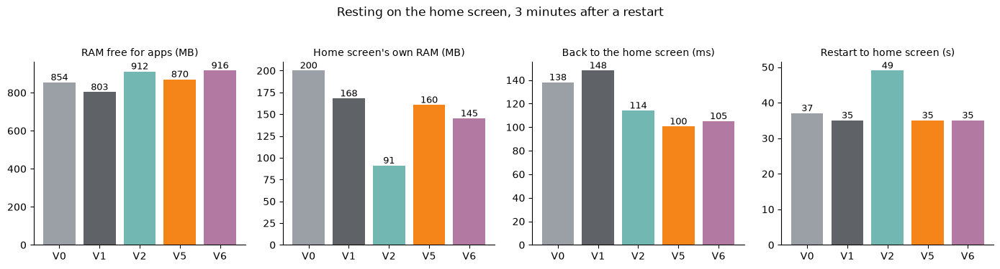
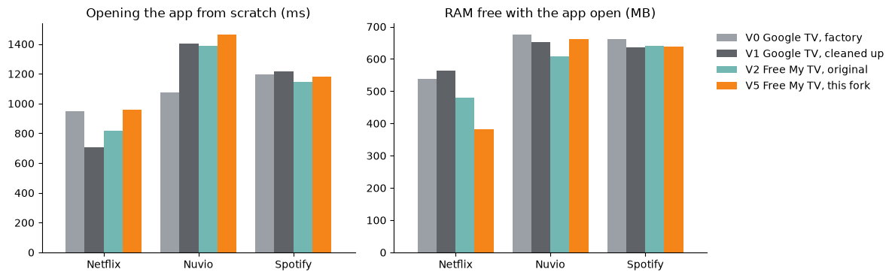
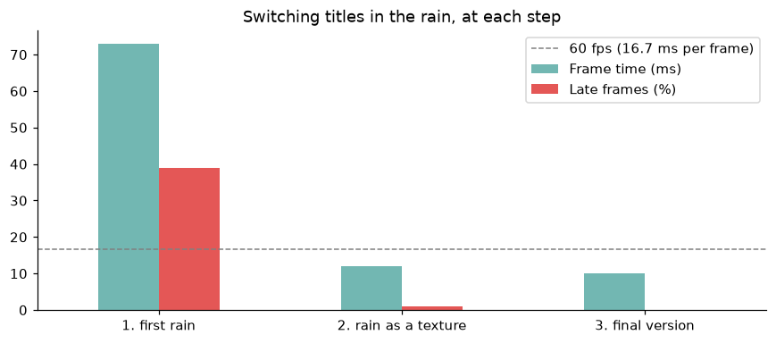

# TV Cleaner Analysis

A Google TV's performance, version by version. A TCL Google TV (Android 12, 2 GB of RAM) went from the factory home
screen to a custom, ad-free one with an animated, illustrated sky
([the app is here](https://github.com/CaueFabrizioBS/free-my-tv)). Was each step faster or slower? This project
puts every version through the same test on the TV, keeps a log of how the home screen runs through the day, and
shows it all in a notebook and a Streamlit dashboard.

<p align="center"></p>

## The versions

| Version | What it is |
|---|---|
| **V0** Google TV, factory | as it came: Google's home screen, every pre-installed extra on, normal animations |
| **V1** Google TV, cleaned up | 20 unused extras turned off (never uninstalled), animations at 0.5× |
| **V2** Free My TV, original | the open-source, ad-free home screen as published |
| V3, V4 | picks, title shelf, then the animated sky and weather (measured only at the time) |
| **V5** Free My TV, this fork | sky, weather, lookout tower and music scenes |
| **V6** this fork, lighter sky | the same scenes, the sky painted at half resolution in its own layer, 10 frames a second |

V0, V1, V2, V5 and V6 were rebuilt on the TV the same day and put through **the same test**
(`collector/benchmark.py`): restart the TV, rest 3 minutes on the home screen, then measure memory, how fast the home
screen comes back, 2 minutes moving around it with the arrows, and opening Netflix, Nuvio and Spotify.

## Key findings

<p align="center"></p>

* **Faster back home.** The home screen comes back in about 100 ms with Free My TV against 140 to 150 ms with Google's.
  Through the remote's Home button the gap is bigger: 738 ms on Google's home screen against 96 ms.
* **Less memory than Google's, more than the original.** Google's home screen uses 170 to 200 MB of RAM; the
  original Free My TV, 91 MB; this fork about 160 MB, 145 MB with the lighter sky.
* **Turning off the extras freed no memory** (V0 to V1): unused extras weren't running anyway. The gain is less
  clutter and nothing running in the background.
* **Restarting takes 35 to 50 s in every version:** the home screen isn't what slows it.

<p align="center"></p>

* **From 49 to 57 fps, keeping every scene.** Google's factory home screen draws 83% of its frames at the full
  60 fps (58 fps on average) and the original Free My TV 65% (52 fps). V5 got 36% (49 fps): measured frame by
  frame, the TV's graphics chip was repainting the whole sky on every frame of the shelf moving. V6 paints the sky
  into its own picture at half resolution, only 10 times a second (on purpose, like a hand-drawn cartoon), and the
  open title's photo drifts at 20 frames a second: **74% of the frames at 60, 57 fps on average, 2% late**.

<p align="center"></p>

* **The apps open just as fast** in every version (Netflix about 0.9 s, Spotify 1.2 s, Nuvio 1.1 to 1.5 s).
  With this fork's home screen waiting behind them there's less RAM free (about 380 MB with Netflix open, against
  540 to 560 MB with Google's), still with room to spare.

<p align="center"></p>

* **How the rain got light:** drawn drop by drop, 39% of the frames came late (73 ms each); as a ready-made texture
  that slides, with the sky still while titles move, 1%; in the final version, none.

Each version ran once (V5 twice): runs of the same version differ by about 5 to 10%, so smaller gaps are noise.

**What's given up.** With Free My TV, Google's home screen is off, and it's what answers the voice assistant's film
and series requests ("show me comedies"): those come back weaker. Opening apps, playing music, the weather and
questions still work. Gemini, Google's newer assistant, isn't offered for this TV yet (the Play Store says it isn't
compatible: Android 12, 2 GB of RAM), so its weight on the home screen couldn't be measured.

## Through the day (in progress)

The home screen keeps its own log on the TV: one line every 15 minutes while the TV is on, even with the PC off
(frame times, free RAM, the app on screen, the sky's period of the day). `collector/pull_tv_log.py` brings it home.
In 2 to 4 weeks the notebook and the dashboard will show the FPS through the day and the average for each period,
from 10:00 to midnight.

## Repository structure

```
tv-cleaner-analysis/
├── .streamlit/config.toml
├── collector/
│   ├── benchmark.py        the same test on any version of the home screen
│   ├── pull_tv_log.py      brings home the log the TV keeps by itself
│   ├── collect.py          a snapshot of packages, memory and today's app usage
│   ├── frames.py           the home screen's frames since the last run (when the PC is on)
│   ├── build_datasets.py   anonymizes the raw data into datasets/
│   └── update.bat          pull + build, for Windows' Task Scheduler
├── datasets/               the anonymized data
├── images/
├── notebooks/EDA.ipynb     the full analysis
├── app.py                  the Streamlit dashboard
└── requirements.txt
```

**Privacy.** The raw data stays in `datasets/private/`, which is never committed. The public files have no IP
address and no dates (a date is *day N*), and screen time is a share of the total, not hours.

## Run it

```bash
pip install -r requirements.txt
streamlit run app.py
```

### Test your own TV

You need [adb](https://developer.android.com/tools/releases/platform-tools) and the TV's developer options with USB
debugging on (Settings → System → About → press *Android TV OS build* 7 times). The benchmark restarts the TV.

```bash
python collector/benchmark.py 192.168.1.50 "V0 my factory home screen"
python collector/build_datasets.py
```

## Tools

Python, pandas, NumPy, matplotlib, Plotly, Streamlit, adb (Android Debug Bridge), and Java for the TV-side log.
