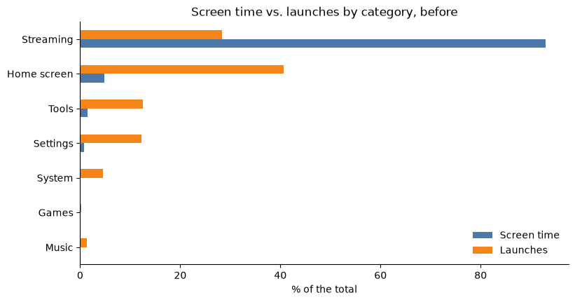

# TV Cleaner Analysis

How a smart TV was cleaned up, measured with its own data. A TCL Google TV (Android 12, 2 GB of RAM) had its
pre-installed extras turned off and got a new, ad-free home screen with a living illustrated sky
([the app is here](https://github.com/CaueFabrizioBS/free-my-tv)). This project collects data from the TV over
adb, cleans and anonymizes it, explores it in a notebook and shows it in a Streamlit dashboard.

<p align="center"></p>

## What the analysis answers

* Where did the screen time go before any change, and which screens do people pass through most?
* Which packages were turned off, back on, installed or removed, and why?
* Did turning off the extras free memory?
* How much did the new home screen cost, and how were its frame times brought under 16.7 ms (60 fps)?
* Does the TV today still match the log of changes, or did something drift?

## Key findings

<p align="center"></p>

* **Three streaming apps held about 90% of the screen time** (Netflix, YouTube, Prime Video), while the home screen
  had only 2.5% of the time but **35% of the launches**: everyone passes through it, so it's the one screen worth
  making fast and ad-free.
* **None of the 15 pre-installed extras had ever been used.** All 15 were turned off; nothing was uninstalled from
  the system, so every change can be undone with one command.
* **Turning them off freed only about 11 MB:** disabled apps that weren't running weren't using memory. The gain is
  less clutter and nothing running in the background, not free RAM.
* **Frame times:** the first version of the animated rain made 39% of the frames late (73 ms each). Redrawing it as
  a sliding texture brought it to 1%, and the final version renders a frame in about 10 ms.
* **Drift caught:** the latest snapshot shows YouTube Music turned off, although the log says it was turned back on.
  That's what the collector is for.

<p align="center"></p>

## Repository structure

```
tv-cleaner-analysis/
├── .streamlit/
│   └── config.toml
├── collector/
│   ├── collect.py
│   └── build_datasets.py
├── datasets/
│   ├── apps.csv
│   ├── changes.csv
│   ├── performance.csv
│   ├── usage_before.csv
│   ├── snapshots_system.csv
│   ├── snapshots_packages.csv
│   └── snapshots_usage.csv
├── images/
├── notebooks/
│   └── EDA.ipynb
├── .gitignore
├── app.py
├── README.md
└── requirements.txt
```

* `collector/collect.py`: takes a snapshot of the TV over adb (packages, memory, storage, the home screen's frame
  times, today's screen time per app). Read-only: nothing on the TV changes and nothing shows on screen.
* `collector/build_datasets.py`: turns the raw snapshots into the public datasets.
* `datasets/`: the anonymized data used by the notebook and the app.
* `notebooks/EDA.ipynb`: the full analysis, with the charts.
* `app.py`: the Streamlit dashboard.

## The data

| File | One row per | Columns |
|---|---|---|
| `apps.csv` | package | name, category (Streaming, Music, Games, Home screen, Tools, Bloat, System) |
| `usage_before.csv` | app used before the cleanup | enabled, type, share of screen time and of launches |
| `changes.csv` | change made | day, action (disabled, enabled, installed, uninstalled), round, reason |
| `performance.csv` | measurement | day, stage, metric (free memory, frame time, janky frames...), value |
| `snapshots_*.csv` | collector snapshot | the TV's system state, every package's state and the day's screen time shares |

**Privacy.** The raw collector output stays in `datasets/private/`, which is never committed. The public files have
no IP address, no exact dates or times (a date is *day N*, day 1 being the day the cleanup started) and no hours of
watching (screen time is each app's share of the total).

## Run it

```bash
pip install -r requirements.txt
streamlit run app.py
```

### Collect from your own TV

You need [adb](https://developer.android.com/tools/releases/platform-tools) and the TV's developer options with USB
debugging on (Settings → System → About → press *Android TV OS build* 7 times).

```bash
python collector/collect.py 192.168.1.50
python collector/build_datasets.py
```

Run the collector now and then (each run adds a snapshot) to follow how the TV changes over time, and write your
own changes in `datasets/changes.csv`. Day 1 is your first snapshot's day (or the date in `datasets/private/day_one.txt`).

## Tools

Python, pandas, matplotlib, Plotly, Streamlit, adb (Android Debug Bridge).
